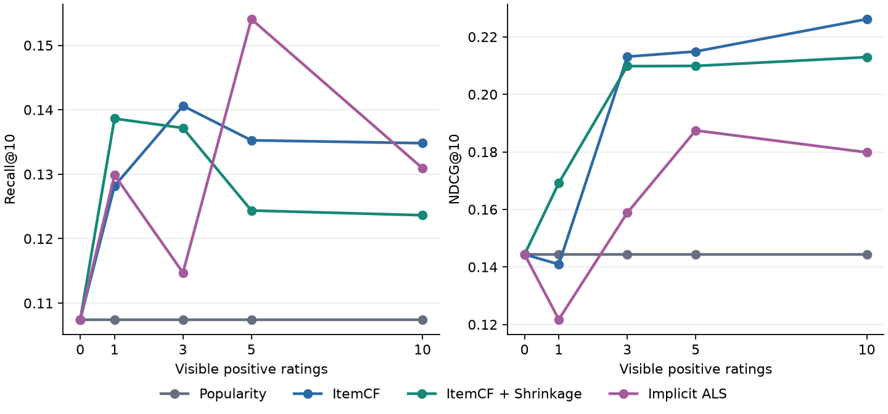

# 固定用户的稀疏历史实验

同一批 70 位用户参与全部实验，测试期共有 1,055 条可达高分记录。
从测试前至少有 10 条可用高分记录、测试期至少有 1 条可达高分记录的用户中构建评估队列。
推荐模型、热门度和电影目录由其他用户在时间截点前的数据构建。模型按时间只看到每位用户最早的 0、1、3、5 或 10 条目录内高分记录。
所有条件使用相同的测试目标和候选集，统一用完整的测试前历史排除已评分电影。
这里的 0 条表示不给模型评分信号，候选集仍排除已评电影。实验用于衡量已积累历史的用户在信息减少时的表现。
加权 ItemCF 在排除评估用户后的验证集选出 λ = 10。验证表的 λ = 0 对应原版 ItemCF。

| 可见高分记录数 | 方法 | Recall@10 | NDCG@10 |
| ---: | --- | ---: | ---: |
| 0 | Popularity | 0.1075 | 0.1444 |
| 0 | ItemCF | 0.1075 | 0.1444 |
| 0 | ItemCF + Shrinkage | 0.1075 | 0.1444 |
| 0 | Implicit ALS | 0.1075 | 0.1444 |
| 1 | Popularity | 0.1075 | 0.1444 |
| 1 | ItemCF | 0.1282 | 0.1409 |
| 1 | ItemCF + Shrinkage | 0.1386 | 0.1692 |
| 1 | Implicit ALS | 0.1299 | 0.1218 |
| 3 | Popularity | 0.1075 | 0.1444 |
| 3 | ItemCF | 0.1406 | 0.2131 |
| 3 | ItemCF + Shrinkage | 0.1372 | 0.2098 |
| 3 | Implicit ALS | 0.1147 | 0.1588 |
| 5 | Popularity | 0.1075 | 0.1444 |
| 5 | ItemCF | 0.1353 | 0.2149 |
| 5 | ItemCF + Shrinkage | 0.1244 | 0.2099 |
| 5 | Implicit ALS | 0.1541 | 0.1875 |
| 10 | Popularity | 0.1075 | 0.1444 |
| 10 | ItemCF | 0.1348 | 0.2262 |
| 10 | ItemCF + Shrinkage | 0.1236 | 0.2129 |
| 10 | Implicit ALS | 0.1309 | 0.1798 |
